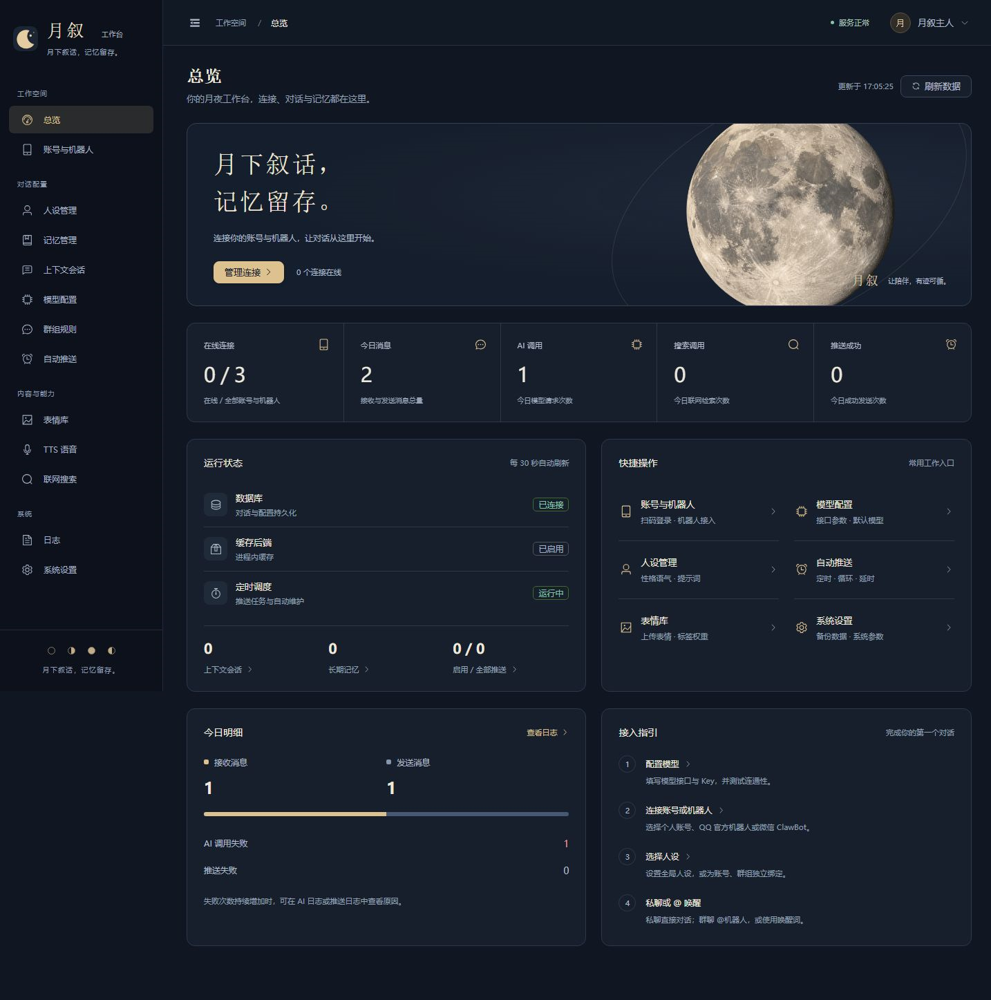
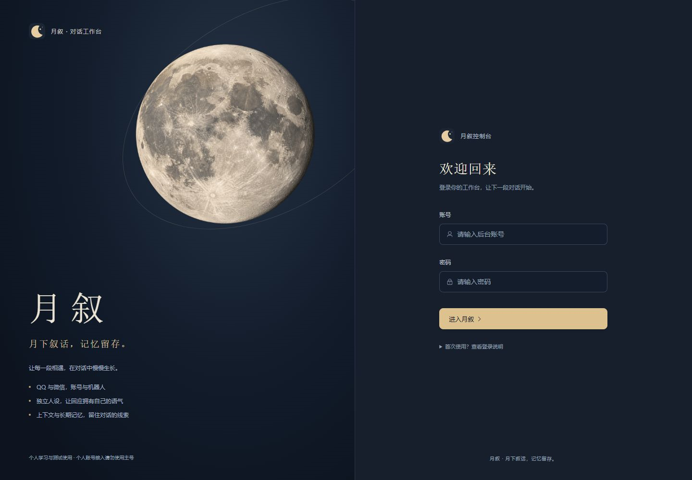
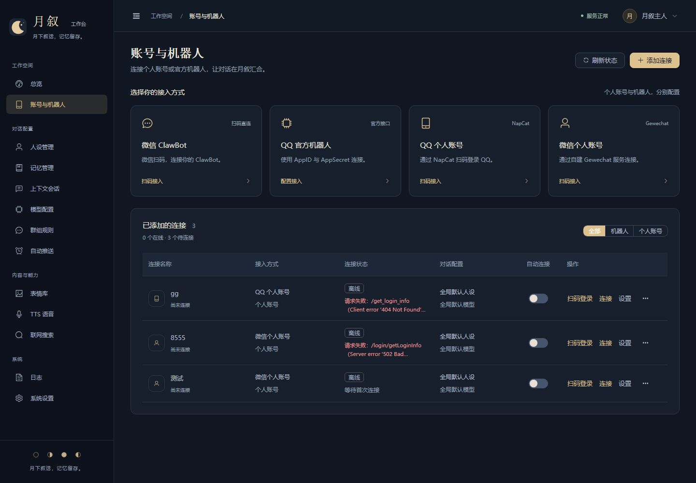

<div align="center">

# 月叙 · AI 多端智能对话机器人

**月下叙话，记忆留存。**

跨 QQ / 微信的拟人化 AI 聊天机器人：私聊与群聊自动应答、群组管理、双层长期记忆、
TTS 语音、表情包、联网搜索，配一套可视化的 Web 控制台。

[](https://www.python.org/)
[](https://fastapi.tiangolo.com/)
[](https://vuejs.org/)
[](LICENSE)

</div>



<p align="center"><sub>控制台首页：连接状态、消息统计、运行状态与快捷入口</sub></p>

---

## 这是什么

月叙是一个可以长期「住」在自己电脑或服务器上的聊天机器人。它把消息接入、对话调度、
人设、记忆、搜索、语音、表情和后台管理拆成独立模块，用一套 Web 控制台完成所有配置。

- **多平台**：QQ 个人号（NapCat / OneBot11）、QQ 官方机器人、微信 ClawBot，
  以及兼容已有 Gewechat 服务；
- **会记事**：上下文滑动窗口 + 向量长期记忆，分冷热、分场景隔离，能确认 / 否认 / 忘记；
- **像个人**：人设支持全局 / 单账号 / 单群三级覆盖，可调活泼度、表情频率、回复长度；
- **能干活**：群管理、定时推送、活力 Agent 主动搭话、TTS 语音、生图、表情包、联网搜索；
- **看得见**：13+ 个后台页面，桌面与手机自适应，参数全部可视化。

> 仓库不包含任何真实账号、密钥、聊天记录或内部测试用例；内置人设也只是示例。

---

## 界面预览

| 登录 | 账号与机器人 |
| --- | --- |
|  |  |

---

## 功能

### 对话与人格

| 能力 | 说明 |
| --- | --- |
| 私聊应答 | 默认开启，支持上下文连续对话 |
| 群聊应答 | @ 触发、关键词触发、正则触发，可设唤醒词 |
| 三级人设 | 单群 > 单账号 > 全局默认，Prompt 可预览 |
| 人设参数 | 风格、活泼度、表情频率、记忆唤起频率、回复长度、共情强度、主动性 |
| 生活作息 | 按时间段描述「在干嘛」，回答更自然 |
| 情绪状态 | 可选 LLM 判定情绪，影响回复语气 |
| 主动搭话 | 活力 Agent：静默后按无聊分与动态阈值主动开口 |

### 记忆

- **短期上下文**：Redis 或进程内缓存，支持 TTL、冻结、滑动窗口、过期回收；超长会话自动压缩为分段笔记，预算按 token 估算而不是 UTF-8 字节；
- **长期记忆**：内置向量引擎开箱可用，可选 Chroma；按「记忆库 + 目标类型 + 目标 ID」分区隔离；
- **冷热分层**：热 / 温 / 冷三级，热度每日衰减，确认加分、否认屏蔽，被召回使用后小幅回馈；
- **双检索模式**：精确回忆与模糊回忆自动切换，模糊结果只作为线索；
- **写入提纯**：LLM 抽取优先、规则抽取兜底，写入前查重并批量嵌入；重复提及时小幅回馈原记忆，姓名 / 住址等身份事实变更时自动作废旧值；
- **可管理**：后台检索、确认、否认、编辑、导出、维护任务、换号续用记忆库。

### 接入

| 通道 | 方式 | 说明 |
| --- | --- | --- |
| QQ 个人号 | NapCat + OneBot11 | Windows 可自动下载并托管 NapCat，扫码即用；也可连接已有服务 |
| QQ 官方机器人 | OpenAPI / WebSocket | 填 AppID / AppSecret，支持群 @ 与单聊 |
| 微信 ClawBot | 官方 iLink | 扫码确认，当前支持私聊文本 |
| 微信个人号 | Gewechat | 仅兼容已有服务（上游已停止维护） |

### 内容能力

- **TTS**：Edge-TTS 免费音色，或 OpenAI 兼容 / MiniMax 云端语音；失败自动降级为文字；
- **生图**：OpenAI 兼容 Images API，后台可预览，支持 `/image`、`/draw` 指令；
- **表情包**：上传、别名、权重、标签解析，按语境自动发送；
- **联网搜索**：DeepSeek Search，可配置端点，识别时效问题自动触发，也可 `/search`；
- **语音通话**（可选）：本地 SenseVoice ASR + PCM 通话桥，需要 Windows 与虚拟音频线路。

### 管理与运维

群规则（欢迎、退群、黑名单、屏蔽词、防刷屏、禁言、踢人）、定时 / 循环 / 延时推送、
五类日志与 CSV 导出、数据备份、服务状态、队列与任务查看、API 文档。

---

## 技术栈

| 层 | 选型 |
| --- | --- |
| 后端 | Python 3.12 · FastAPI · SQLAlchemy 2 (async) · APScheduler · Pydantic 2 |
| 数据 | SQLite（默认）/ PostgreSQL · Redis（可选，缺省自动降级） |
| 向量 | 内置轻量向量引擎（默认）/ Chroma（可选） |
| 前端 | Vue 3 · Vite · Element Plus · Pinia · Axios |
| 协议 | NapCat / OneBot11 · QQ 官方 OpenAPI · 微信 ClawBot / Gewechat |
| 部署 | Windows 一键脚本 · Docker Compose |

---

## 架构

```text
NapCat / Gewechat / QQ 官方网关 / ClawBot
   │  HTTP  /api/bot/onebot/{account_id}
   │  WS    /api/bot/onebot/ws/{account_id}
   ▼
Adapter.parse_event → BotEvent（统一消息结构）
   ▼
BotDispatchService
   限流 → 黑名单 / 屏蔽词 / 防刷屏 → 指令 → 关键词
   → 上下文 → 搜索 → 人设 → 长期记忆 → LLM
   → 表情 / 语音 / 生图 → Adapter 发送 → 写上下文 → 抽取记忆 → 日志
   ▼
Repository（SQL / 缓存 / 向量库）
```

扩展点：`backend/core/hooks.py` 提供 `dispatch.received`、`llm.pre`、`llm.post`、
`send.pre`、`send.post` 等钩子，新增画图、音乐、小游戏等能力无需改主链路。

---

## 快速开始

### 环境要求

- Python **3.11+**（推荐 3.12）
- Node.js **18+**（仅构建前端时需要）
- Windows 10/11、Linux x64 / arm64 均可

### 方式一：Windows 一键包

```bat
deploy\windows_pack\install.bat        :: 建虚拟环境、装依赖、生成 config.yaml
deploy\windows_pack\build_frontend.bat :: 构建前端（首次或前端改动后）
deploy\windows_pack\start.bat          :: 启动并打开 http://127.0.0.1:8000
```

### 方式二：手动启动

```bash
python -m venv .venv
.venv\Scripts\activate                 # Linux: source .venv/bin/activate
pip install -r requirements.txt
pip install -r requirements-optional.txt   # 可选：edge-tts / chromadb / asyncpg

cp config_example.yaml config.yaml     # Windows: copy
# 修改 security.jwt_secret 与管理员密码后启动
python -m uvicorn backend.main:app --reload --port 8000
```

前端开发（可选，改界面时才需要）：

```bash
cd frontend
npm install
npm run dev        # http://127.0.0.1:5173，/api 自动代理到 8000
```

生产构建后由后端直接托管：

```bash
cd frontend && npm run build     # 生成 frontend/dist，访问 http://127.0.0.1:8000
```

### 方式三：Docker Compose

Linux 服务器见 [`deploy/docker/README.md`](deploy/docker/README.md)，包含 QQ 自动扫码容器、
镜像加速与离线导入：

```bash
cd deploy/docker
cp ../../config_example.yaml ./config.yaml
cp .env.example .env
docker compose -f docker-compose.server.yml up -d --build
```

### 首次登录

默认后台账号为 `admin / admin123`（来自 `config.yaml → security.admin`），**登录后请立即修改**。

---

## 配置

所有配置从 `config_example.yaml` 继承，`config.yaml` 覆盖，支持 `${ENV:-默认值}` 环境变量。
`config.yaml` 已在 `.gitignore` 中，不会被提交。

| 配置项 | 说明 |
| --- | --- |
| `security.jwt_secret` | 后台登录签名密钥，**必须改成随机长字符串** |
| `security.admin` | 初始管理员账号、密码、昵称 |
| `database.url` | SQLite 或 PostgreSQL 连接串 |
| `redis.enabled` | 关闭时上下文存内存，重启后从数据库恢复 |
| `memory.*` | 冷热天数、双模式阈值、召回缓存、超时与维护策略 |
| `search.*` | DeepSeek Search 地址与 Key，自动触发关键词 |
| `tts.*` | Edge / OpenAI 兼容 / MiniMax，音色、语速、触发策略 |
| `image_generation.*` | 云端生图地址、模型、尺寸与缓存 |
| `rate_limit.*` | 用户 / 群 / 账号 / 推送限流与随机延时 |
| `adapters.*` | 各通道默认地址、NapCat WebUI 与重连间隔 |

后台「系统设置」保存的改动会写回 `config.yaml`；端口类配置需重启生效。

### 模型怎么选

模型在后台「模型配置」里添加，兼容 OpenAI 格式即可：

- **本地部署**：Ollama，地址填 `http://127.0.0.1:11434/v1`，模型填 `qwen2.5:7b` 等，
  不产生调用费用，数据不出本机，适合长期挂机；
- **云端 API**：DeepSeek、通义千问、豆包等，按量或按月订阅，效果更稳、免维护，
  适合不想折腾显卡的场景。

两种可以同时配置，主模型超时或失败时自动切换备用模型。

### 密钥安全

- 不要把 `config.yaml`、`.env`、数据库、日志、二维码提交到仓库；
- 推荐把 Key 写在环境变量里，例如 `DEEPSEEK_SEARCH_KEY`、`YUEXU_TTS_API_KEY`；
- 如果曾经把 Key 写进公开仓库，请立刻到服务商后台吊销并重新生成。

---

## 内置人设

开源版内置一个示例人设「**小满**」：温和、慢热、有点冷幽默的朋友型角色，
设定写在 [`docs/人设示例.md`](docs/人设示例.md)，代码入口是
`backend/common/character_defaults.py`。

它在首次建库时写入数据库，之后完全由后台管理：

- 在「人设管理」里直接改字段、调风格参数、预览 System Prompt；
- 新建多条人设，分别绑定到账号或群，实现三级覆盖；
- 支持 JSON 导入 / 导出，方便备份和分享。

想彻底换成自己的角色，改后台里的名称、档案和说话方式即可，不需要动代码。
人设系统的字段与 Prompt 组装顺序见 [`docs/人设系统.md`](docs/人设系统.md)。

---

## 目录结构

```text
.
├── backend
│   ├── main.py                # 入口：装配、路由、生命周期
│   ├── dependencies.py        # 会话、鉴权、Service 工厂
│   ├── common/                # 异常、日志、工具、消息结构、缓存、加密
│   ├── core/                  # 配置、调度器、账号状态、钩子、运行时容器
│   ├── routers/               # 薄路由（参数校验 + 调用 Service）
│   ├── services/              # 业务 Service + 分发中心 + 定时任务
│   ├── repositories/          # 数据访问（SQL / 缓存 / 向量库）
│   ├── adapters/              # NapCat / Gewechat / QQ Bot / ClawBot
│   └── database/              # ORM 模型、引擎、初始化数据
├── frontend
│   ├── src/api/               # Axios 接口封装
│   ├── src/views/             # 后台页面
│   ├── src/layouts/           # 控制台布局
│   ├── src/router/            # 路由与登录守卫
│   └── src/stores/            # Pinia
├── deploy
│   ├── windows_pack/          # 安装 / 启动 / 前端构建脚本
│   ├── docker/                # Dockerfile / Compose / env 模板
│   └── voice_call/            # 可选：本地 ASR 与通话桥脚本
├── docs/                      # 接入、人设、记忆、语音文档与截图
├── static/                    # 表情、语音缓存、二维码临时目录
├── data/                      # SQLite、Chroma、备份（不入库）
├── config_example.yaml        # 配置模板（仓库里唯一的配置样本）
└── requirements.txt
```

---

## 文档

| 文档 | 内容 |
| --- | --- |
| [接入指南](docs/接入指南.md) | QQ / 微信四种通道的扫码、回调与排障 |
| [人设系统](docs/人设系统.md) | 三级覆盖、Prompt 组装、风格参数 |
| [人设示例](docs/人设示例.md) | 内置「小满」完整设定 |
| [记忆与回复优化](docs/记忆与回复优化.md) | 双层记忆、召回与回复节奏 |
| [语音与生图](docs/语音与生图.md) | TTS、云端生图的模型与缓存 |
| [主动推送](docs/proactive_push.md) | 活力 Agent 与私聊惦记策略 |
| [开发文档](docs/开发文档.txt) | V1.2 需求与整体设计 |
| [后端说明](backend/README.md) / [前端说明](frontend/README.md) | 分层约定与本地开发 |

启动后访问 `http://127.0.0.1:8000/docs` 查看完整 API。

---

## 常见问题

**QQ 登录要装 QQ 吗？**
Windows x64 不需要。程序会自动下载固定版本的 NapCat 完整包并独立运行，首次约 124 MB；
Linux 服务器使用本机 Docker Engine 拉取固定镜像。也可以选择「连接已有 NapCat」。

**会不会封号？**
个人账号通道基于第三方协议适配器，本身违反平台用户协议，存在风控与封号风险。
请只用小号测试，不要商用、不要对外提供服务。

**没有显卡能跑吗？**
能。模型走云端 API 时不需要显卡；走本地 Ollama 时 7B 量化模型用 CPU 也能跑，只是更慢。

**记忆存在哪？**
`data/` 目录下的 SQLite 与向量库。换电脑或重装前备份该目录即可，封号不会删除本地记忆。

**前端打不开 / 页面空白？**
先执行 `npm run build` 生成 `frontend/dist`，再重启后端；开发模式请访问 5173 端口。

**依赖下载慢？**
`install.bat` 默认使用国内镜像；也可以手动 `pip install -i https://pypi.tuna.tsinghua.edu.cn/simple -r requirements.txt`。

---

## 安全与合规

- 本项目仅用于**个人学习与技术研究**，请遵守当地法律法规与平台用户协议；
- 个人账号通道存在封号风险，**禁止使用主号**，禁止商用、群发、骚扰或对外提供公开服务；
- 后台默认密码务必修改，`jwt_secret` 务必替换，公网部署请加 HTTPS 与访问控制；
- 机器人产生的对话内容由使用者负责，请勿用于伪造身份、诈骗、侵权或传播违法信息；
- 仓库不含任何账号数据、密钥或聊天记录；`.gitignore` 已默认排除配置、数据库与日志。

## 免责声明

本项目按「现状」提供，不附带任何明示或暗示的担保。因使用本项目导致的账号封禁、
数据丢失、服务中断或其他损失，作者与贡献者不承担责任。使用即表示你已理解并接受上述风险。

## License

[MIT](LICENSE)

## 致谢

- [NapCat](https://github.com/NapNeko/NapCatQQ) 与 OneBot11 生态
- [FastAPI](https://fastapi.tiangolo.com/)、[Vue](https://vuejs.org/)、[Element Plus](https://element-plus.org/)
- [sherpa-onnx](https://github.com/k2-fsa/sherpa-onnx) 的 SenseVoice 语音识别模型
- 所有提交 Issue 与 PR 的贡献者
